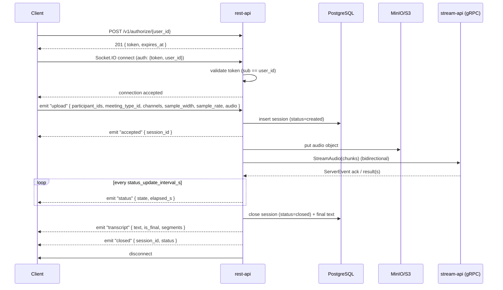

# Rest API Guide

Last verified: 2026-06-22
Audience: External integrators, API consumers

The rest API wraps the streaming transcription pipeline behind a small REST +
Socket.IO surface. A client obtains a token, connects via Socket.IO, then emits
an `upload` event with metadata and audio to receive a transcript.

> Pipeline status: the downstream inference services are still a scaffold, so the
> final transcript may be empty today. The protocol, persistence, and storage
> behavior described here are stable; only the transcript content depends on the
> inference pipeline being completed.

## End-to-End Flow



## REST: `POST /v1/authorize/{user_id}`

Issues a signed connection token for the given user. No session is created at
this stage — sessions are created when the client emits the `upload` event.

Path parameters:

| Parameter | Type   | Notes                          |
| --------- | ------ | ------------------------------ |
| `user_id` | string | Identifies the connecting user |

No request body is required.

Example:

```bash
curl -X POST http://localhost:8080/v1/authorize/alice
```

Response `201 Created`:

```json
{
  "token": "<signed-jwt>",
  "expires_at": "2026-06-22T17:00:00Z"
}
```

### Token details

The token is a JWT (HS256) with the following claims:

| Claim   | Value                |
| ------- | -------------------- |
| `sub`   | The `user_id`        |
| `scope` | `"session:stream"`   |
| `iat`   | Issued-at timestamp  |
| `exp`   | Expires after `REST_API_TOKEN_TTL_S` (default 3600s) |

Present this token in the Socket.IO `auth` payload when connecting.

## Socket.IO: `/socket.io/`

The real-time transport uses [Socket.IO](https://socket.io/) (not a plain
WebSocket). The server is mounted at the default path `/socket.io/`. Clients
should use a Socket.IO client library for their language.

### Connecting

```javascript
import { io } from "socket.io-client";

const socket = io("http://localhost:8080", {
  auth: { token: "<jwt>", user_id: "alice" },
});
```

The server validates the token on connect:

- Token must be a valid, unexpired JWT signed with the server secret
- The `sub` claim must match the provided `user_id`

On failure, the connection is refused with one of:

| Error code             | Meaning                                      |
| ---------------------- | -------------------------------------------- |
| `TOKEN_EXPIRED`        | Token has expired                            |
| `INVALID_TOKEN`        | Signature invalid or token malformed         |
| `TOKEN_USER_MISMATCH`  | `sub` claim does not match provided user_id  |

### Client → Server events

#### `upload`

Sends audio for transcription. The server creates a session, processes the audio,
and emits results.

Payload:

| Field             | Type       | Notes                                                       |
| ----------------- | ---------- | ----------------------------------------------------------- |
| `participant_ids` | `string[]` | Non-empty; at least one participant                         |
| `meeting_type_id` | `integer`  | References a seeded meeting type; unknown ids are rejected  |
| `channels`        | `integer`  | Number of audio channels; forwarded unchanged downstream    |
| `sample_width`    | `integer`  | Bytes per sample; forwarded unchanged downstream            |
| `sample_rate`     | `integer`  | Sample rate in Hz; forwarded unchanged downstream           |
| `audio`           | `bytes`    | Raw audio data (max 100 MB by default)                      |

Acknowledgement callback returns: `{ "session_id": "<uuid>" }`

Example (Python):

```python
import socketio

sio = socketio.Client()
sio.connect("http://localhost:8080", auth={"token": token, "user_id": "alice"})

with open("meeting.wav", "rb") as f:
    audio_data = f.read()

response = sio.call("upload", {
    "participant_ids": ["alice", "bob"],
    "meeting_type_id": 3,
    "channels": 1,
    "sample_width": 2,
    "sample_rate": 16000,
    "audio": audio_data,
})
print(response)  # {"session_id": "f2b1...-uuid"}
```

#### `restore_session`

Rejoins the room for an existing session to receive further events.

Payload:

| Field        | Type   | Notes                  |
| ------------ | ------ | ---------------------- |
| `session_id` | string | UUID of prior session  |

Acknowledgement callback returns the session snapshot:

```json
{
  "session_id": "f2b1...-uuid",
  "status": "closed",
  "text": "transcribed text...",
  "created_at": "2026-06-22T15:00:00Z",
  "updated_at": "2026-06-22T15:01:30Z"
}
```

Or on failure: `{ "error": "session_not_found" }`

### Server → Client events

| Event        | Payload                          | When                                                            |
| ------------ | -------------------------------- | --------------------------------------------------------------- |
| `accepted`   | `{ session_id }`                 | After session is created, before processing begins              |
| `status`     | `{ state, elapsed_s }`           | Every `status_update_interval_s` (default 2s) while processing  |
| `transcript` | `{ text, is_final, segments[] }` | Once processing completes                                       |
| `closed`     | `{ session_id, status }`         | After the session is marked closed; server disconnects client   |
| `error`      | `{ code, message }`              | On failure; server disconnects client after emitting            |

Each `segments[]` entry: `{ text, is_final, sequence }`.

### Error codes (emitted via `error` event)

| Code                       | Meaning                                        |
| -------------------------- | ---------------------------------------------- |
| `INVALID_METADATA`         | Missing or invalid participant_ids / meeting_type_id |
| `UPLOAD_TOO_LARGE`         | Audio exceeds maximum allowed size             |
| `UPSTREAM_STREAM_FAILURE`  | stream-api gRPC call failed                    |
| `INTERNAL`                 | Unexpected server error                        |

### Disconnection behavior

If the client disconnects while a session is active (upload in progress), the
server marks the session as `FAILED` in the database.

## Persistence Model

Sessions are stored in PostgreSQL. `status` and `meeting_type_id` are integer
foreign keys into the seeded `session_status` and `meeting_type` lookup tables.

`sessions`:

| Column                      | Type        | Notes                                                                                      |
| --------------------------- | ----------- | ------------------------------------------------------------------------------------------ |
| `session_id`                | UUID        | Primary key (the external/canonical id).                                                   |
| `participant_ids`           | `text[]`    | Array of participant identifiers.                                                          |
| `meeting_type_id`           | integer     | FK → `meeting_type.id`.                                                                    |
| `status_id`                 | integer     | FK → `session_status.id` (`created` → `streaming` → `processing` → `closed`, or `failed`). |
| `text`                      | text        | Final aggregated transcript text.                                                          |
| `created_at` / `updated_at` | timestamptz | Lifecycle timestamps.                                                                      |

`meeting_type` (seeded lookup):

| Column | Type    | Notes                                                                   |
| ------ | ------- | ----------------------------------------------------------------------- |
| `id`   | integer | Primary key.                                                            |
| `code` | text    | Unique. Seeded: `waiting`, `processing`, `screening`, `done`, `failed`. |

`session_status` (seeded lookup):

| Column | Type    | Notes                                                                     |
| ------ | ------- | ------------------------------------------------------------------------- |
| `id`   | integer | Primary key.                                                              |
| `code` | text    | Unique. Seeded: `created`, `streaming`, `processing`, `closed`, `failed`. |

> Per-segment confidence is logged for observability but is not persisted; the
> `transcript` server message still carries the in-memory `segments[]`.

See the [rest-api entity-relationship diagram](../contributor/services/rest-api/data-model.md)
for a visual overview.

Audio files are archived to object storage (MinIO/S3) under
`sessions/{session_id}/audio/{filename}`.

## Object Storage

Uploaded audio is stored via the S3 protocol (MinIO in local development). The
destination bucket (default `stt-audio`) is created automatically at startup if it
does not exist.

## Error Response Shape

REST errors and WebSocket `error` messages share a stable envelope:

```json
{ "code": "session_not_found", "message": "session not found" }
```
