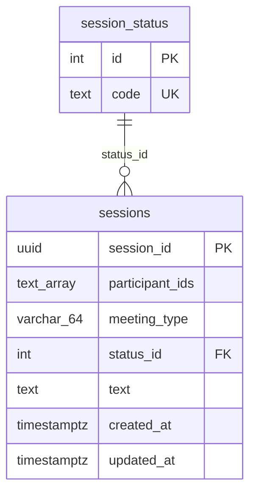

# Rest API Data Model

Audience: Contributors
Last verified: 2026-08-23

Entity-relationship diagram for the rest-api PostgreSQL schema. `status_id` on
`sessions` is an integer foreign key into the seeded `session_status` lookup
table, while `meeting_type` is stored directly on `sessions` as a free-form
string.

## Notes

- `participant_ids` is a PostgreSQL `text[]` array.
- `meeting_type` is stored directly on `sessions` as a free-form string
    (`VARCHAR(64)`), not a foreign key to a lookup table.
- `session_status` is seeded with: `created`, `streaming`, `processing`,
  `closed`, `failed`.
- Per-segment transcription confidence is logged for observability but is not
  persisted. The aggregated final transcript is stored in `sessions.text`.

See the [consumer-facing persistence model](../../../consumer/rest-api-guide.md#persistence-model)
for column-level notes.
